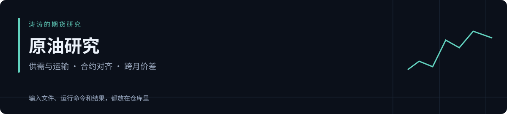

# 原油研究 Skill

把“事件叙事”拆成供给、需求和物流三条传导链，再检查库存、期限结构与价格是否给出同一答案。

作者：[Serennity007](https://github.com/Serennity007) · [四类研究导航](https://github.com/Serennity007/market-research-skills) · [完整 Skill](SKILL.md) · MIT

## 研究工作台 · v1.1

**Python 3.10+ · 标准库 · 离线运行 · 独立安装**

```bash
python scripts/run_research.py --config examples/workbench.json --out output
```

打开终端打印的 `REPORT.html`：一次完成结构检查、领域计算、高级对照与证据整理，同时保存 Markdown、JSON 和可重跑输入。重复运行使用新目录。

**[先看完整模拟报告](examples/workbench/REPORT.md)** · [计算与来源](examples/workbench/bundle.json) · [工作台与高级数据](references/workbench.md) · [Skill 指令](SKILL.md)

**原油：固定合约的曲线变化**：使用相同合约比较两期跨月价差，列出新增和移除合约，避免端点变化干扰。

## 能做什么

1. 确认 WTI、Brent 或 SC，指定交易所/来源、合约月、币种与每桶口径。禁止把主连跳空当成真实可交易收益。
2. 分开研究供给损失、需求变化、物流绕行、库存与可用产能；对每个冲击写传导机制和反证。
3. 需要期限结构时读取 `references/domain-data.md`，用同一基准、币种和单位的跨月报价计算；检查异步报价及陈旧时间。
4. 以已收盘 K 线核验价格结构，写基准/上行/下行情景和撤销条件。近月升水可能反映当期紧张，不保证远月或现价上涨。
5. 原观点与后续复盘分开，记录数据公布时刻与换月/成本口径；如无成交记录，不输出实盘收益。

这是可单独使用的研究 Skill：指令、参考、示例和计算脚本都在本仓库内，不依赖其他三个项目。离线脚本使用 Python 3.10+ 标准库，无 API Key。

## 快速体验

```bash
git clone https://github.com/Serennity007/crude-oil-research-skill.git
cd crude-oil-research-skill
python scripts/analyze_structure.py --csv examples/bars.csv --instrument WTI_SYNTHETIC --timeframe H4 --as-of 2024-01-09T00:00:00+00:00 --data-kind synthetic --support 100 --out output/structure.json
python scripts/analyze_curve.py --csv examples/curve.csv --as-of 2024-01-09T00:00:00Z --data-kind synthetic --out output/curve.json
python -m unittest discover -s tests -v
```

输出保存在 `output/`。重复运行请换文件名；脚本拒绝覆盖输入和已有结果。

先看 [输入样例](examples/bars.csv)、[结构计算输出](examples/structure-output.json) 和 [数据约定](references/data-contract.md)。K 线例子是 2024 年时间标签的构造数据，统一使用虚构标的名；归档时间不代表 2024 年曾经做过此分析。末端收复支撑但均线方向仍有分歧，示范如何保留冲突证据。

[领域工具数据规范](references/domain-data.md) · [领域计算输出](examples/domain-output.json)

## 作为 Skill 使用

把本仓库完整复制到使用工具支持的技能目录，保留文件夹名 `crude-oil-research-skill`。例如 Codex 的用户技能目录为 `~/.codex/skills/crude-oil-research-skill`；有图形界面或其他代理时按其技能目录约定安装。

```text
使用 $crude-oil-research-skill，标的是……，截止时间是……，数据来自……。
请核查证据与时效，给出有条件的研究结论、失效条件及复盘检查点。
```

需要当前行情时，使用者提供带来源和时间的文件，或由其已授权的数据工具获取。此仓库不内置行情订阅、账户接入和自动下单。

## 证据与验证范围

计算测试覆盖时间截止、输入校验、指标/领域算术和命令行文件保护。`examples/` 全部是 **synthetic 模拟样例**，用于验证功能；没有宣称真实行情测试、纸面账户收益或实盘盈利。作者的历史观点与证据等级见 [方法说明](references/method.md)。

共同 K 线引擎从作者 [选股与量化技能合集](https://github.com/Serennity007/awesome-stock-quant-skills/tree/67156b0aa4860894a8cdbc66b797db535531fe59/my-skills/gold-cross-asset-research) 的已收盘数据分析器适配而来。各仓库随带自身代码与测试，互不需要联网导入。

[研究与复盘记录模板](references/report-template.md) · [官方来源](references/sources.md)

本地验证（2026-10-25）：**26 项测试通过**，覆盖原有功能、新领域算术、未来信息隔离、输入冻结与重跑、跨目录 CLI 和 HTML 转义。测试数量是可重复执行的行为检查数，不代表研究胜率。
